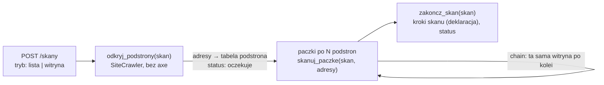

# Kolejka skanów wielu podstron (F4) – przygotowanie w sprincie 2, wdrożenie w sprincie 3

Osoby 6 i 1. Ten dokument to **propozycja do uzgodnienia z osobą 1 (crawler)** – decyzje oznaczone ❓.

## Co jest gotowe po sprincie 2

| Element | Gdzie | Kto |
|---|---|---|
| Crawler wielu podstron: BFS, limity, robots.txt, deduplikacja, `crawl.json` | `audytor.crawler.crawl.SiteCrawler` | osoba 1 |
| Lista podstron dla skanu (start + podane, limit 50) | `audytor.skan.lista_podstron` | osoba 2 |
| Skan listy podstron w jednym zadaniu Celery, limit tempa, budżet 480 s | `audytor.worker.zadania.wykonaj_skan` | osoby 2, 6 |
| Kroki modułów na podstronie i na skanie (alt, fokus, deklaracja) | `audytor.worker.kroki` | osoba 6 |
| API: `podstrony`, `max_podstron`, postęp (`planowane_podstrony`, `liczba_podstron`) | `POST /skany`, `GET /skany/{id}` | osoba 6 |

Ograniczenia obecnego modelu „jeden skan = jedno zadanie”:

- **Czas.** Cały skan musi zmieścić się w limicie zadania Celery (540 s). Przy pauzie 1 s i ok. 5 s
  na podstronę z krokami to ok. 50–80 podstron, a bez dzielenia nie da się więcej.
- **Brak ponawiania.** Padnięty worker (restart, brak pamięci w Chromium) oznacza skan od nowa
  (`acks_late`) albo `blad`.
- **Brak równoległości.** Jeden worker skanuje jedną witrynę po kolei, a pozostałe czekają na swoją kolej.

## Propozycja na sprint 3

1. **Odkrywanie** to osobne zadanie `odkryj_podstrony`. Uruchamia `SiteCrawler` (osoba 1) z limitami
   z parametrów skanu i zapisuje listę adresów. Dla trybu „lista” (sprint 2) od razu bierze
   `lista_podstron`.
2. **Paczki.** Lista jest dzielona na paczki po N podstron (np. 10), a każda paczka to osobne zadanie
   z własnym limitem czasu i **ponawianiem**: `autoretry_for=(RenderError, ConnectionError)`,
   `max_retries=2`, `retry_backoff`. Ponowienie pomija podstrony już zapisane, bo podstrona jest
   unikalna w skanie (`uq_podstrona_skan_url`).
3. **Limit tempa między workerami.** Paczki jednej witryny idą łańcuchem (`chain`), czyli po kolei,
   więc limit tempa z `Ogranicznik` nadal wystarcza. Równolegle działają skany różnych witryn.
   ❓ Alternatywa to wspólny limit w Redisie (`SET host NX PX delay`), który pozwoliłby na
   równoległość w obrębie witryny, ale to więcej kodu i ryzyko przeciążenia małych serwerów gmin.
4. **Zakończenie.** `zakoncz_skan` (ostatnie ogniwo łańcucha) uruchamia kroki skanu (deklaracja)
   i ustawia status. Podstrony z błędem nie psują skanu, tak jak teraz.
5. **Postęp.** API już pokazuje `planowane_podstrony` i `liczba_podstron`. Po odkrywaniu
   `planowane_podstrony` = liczba odkrytych adresów.

## Do ustalenia z osobą 1

- ❓ **Jedno czy dwa przejścia?** Crawler ma hak `on_page(opened, strona)`, więc axe i kroki mogłyby
  działać już podczas crawlowania (jedno wczytanie strony zamiast dwóch). Propozycja: w sprincie 3
  dwa przejścia (odkrywanie, potem skan paczek), bo to prostsze, daje paczki z ponawianiem i postęp
  z góry znany. Jedno przejście wrócić rozważyć jako optymalizację.
- ❓ **Format listy.** Czy zadanie odkrywania zapisuje `crawl.json` (sekcja 1.7 kontraktu) w folderze
  skanu, czy tylko adresy w bazie? Propozycja: oba – plik do diagnostyki, a adresy w bazie jako
  podstrony ze statusem „oczekuje”. Wymaga migracji 0003, czyli nowej kolumny `podstrona.status`.
- ❓ **Limity domyślne** dla trybu „witryna”: głębokość 2, do 100 podstron? Twarde limity: 500
  stron w crawlerze i 50 w obecnej liście.
- ❓ Czy strona startowa przekierowująca na inną witrynę (np. `gmina.pl` → `bip.gmina.pl`) zmienia
  `url_startowy` skanu? Crawler już to obsługuje, a API powinno pokazać to w `uwagi`.

## Szacunek pracy (sprint 3)

| Zadanie | Kto |
|---|---|
| Zadania `odkryj_podstrony`, `skanuj_paczke`, `zakoncz_skan` + łańcuch, ponawianie | osoba 6 |
| Tryb „witryna” w `POST /skany` (`glebokosc`, `max_podstron`) | osoba 6 |
| Migracja 0003: `podstrona.status`, zapis odkrytych adresów | osoby 2, 6 |
| Adapter `SiteCrawler` → lista adresów bez migawek (szybkie odkrywanie) | osoba 1 |
| Testy: paczki, ponawianie, idempotencja zapisu | osoby 1, 6 |
