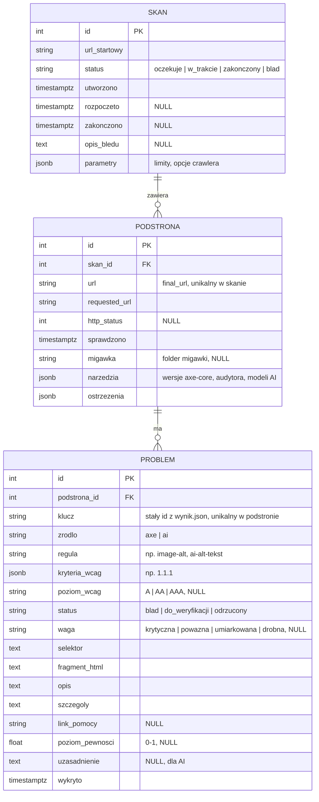

# Model danych v1

Model danych wyników audytu (F7, sprint 1). Kod: `src/audytor/db/models.py`, format wymiany między
modułami: [kontrakt-danych.md](kontrakt-danych.md), sekcja 2.

## Diagram ERD



## Tabele

| Tabela | Co przechowuje | Uwagi |
|---|---|---|
| `skan` | Jedno zlecenie skanu witryny. | `status` to statusy kolejki z F4. `parametry` – opcje, z jakimi skan uruchomiono (głębokość, limit stron itd.). |
| `podstrona` | Jedna sprawdzona podstrona w skanie. | Odpowiada plikowi `wynik.json` bez listy problemów. `url` = `final_url` z migawki. |
| `problem` | Jeden wykryty problem (axe albo AI). | Pola 1:1 z `Problem` z kontraktu (sekcja 2). `klucz` = pole `id` z `wynik.json`. |

## Decyzje projektowe

- **Wspólna tabela dla axe i AI.** Wyniki obu źródeł mają ten sam kształt; różni je tylko `zrodlo`,
  a pola specyficzne dla AI (`poziom_pewnosci`, `uzasadnienie`) dla axe zostają puste lub mają stałą wartość.
- **Wartości wyliczeniowe jako tekst z ograniczeniem CHECK**, a nie natywny `ENUM` PostgreSQL – nowa
  wartość (np. status `poprawiony`) nie wymaga `ALTER TYPE`.
- **Listy jako JSON** (`kryteria_wcag`, `ostrzezenia`), w PostgreSQL jako `JSONB`. Wyszukiwanie problemów
  dla kryterium: `WHERE kryteria_wcag ? '1.1.1'`. Jeśli raporty będą często grupować po kryterium,
  można to później rozbić na tabelę `problem_kryterium`.
- **Stały `klucz` problemu** (skrót z adresu, źródła, reguły i selektora) – ten sam problem w kolejnym skanie
  ma ten sam klucz. Przyda się do wykrywania zmian między skanami (F5) i do cache wyników AI (F15).
- **Usuwanie kaskadowe:** usunięcie skanu usuwa jego podstrony i problemy.
- **Czasy w UTC** (`timestamptz`), jak `fetched_at` w migawkach.

## Użycie

```python
from audytor.db import otworz_baze, zapisz_skan, wynik_podstrony
from audytor.wyniki import wczytaj_wynik

sesje = otworz_baze("sqlite:///audytor.db")   # docelowo: postgresql+psycopg://...
with sesje() as sesja:
    skan = zapisz_skan(sesja, [wczytaj_wynik("wyniki/gov-pl")], url_startowy="https://www.gov.pl/")
    sesja.commit()
    wynik = wynik_podstrony(skan.podstrony[0])   # z powrotem w formacie wynik.json (np. dla API)
```

Z wiersza poleceń: `audytor-scan https://www.gov.pl/ --db sqlite:///audytor.db`.

## Do zrobienia z osobą 6

- **Migracje Alembic.** Do tego czasu tabele tworzy `otworz_baze()` (`Base.metadata.create_all`).
  Pierwsza migracja powinna odtworzyć dokładnie te tabele; potem `create_all` usuwamy.
- **Sterownik PostgreSQL** (np. `psycopg[binary]`) w zależnościach i adres bazy z docker-compose.
